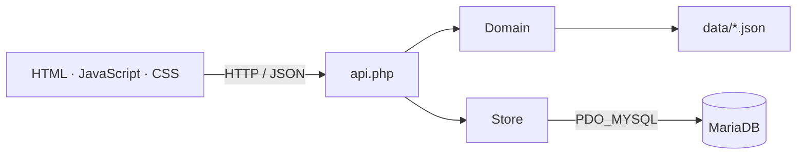

[Versión en Español](es-es/arquitectura.md)

# Architecture

A PHP monolith with separate layers and a framework-free frontend. Entry points are PHP scripts; validation and persistence are grouped into classes.

It does not follow formal MVC or hexagonal architecture: `api.php` coordinates `Domain` and `Store` directly, without a service layer or repository interfaces.

## Stack

| Component | Technology |
| --- | --- |
| Web server | Apache |
| Backend | PHP 8.0+ without a framework |
| Database | MariaDB, InnoDB tables and UTF-8 |
| Data access | PDO_MYSQL, direct SQL with prepared statements |
| Frontend | HTML, vanilla JavaScript and plain CSS in separate files |
| Communication | HTTP and JSON through `fetch` |
| Draft | JavaScript state and `localStorage` |
| Catalogs | Versioned JSON files |

## Layers and components

| Layer | Files | Responsibility |
| --- | --- | --- |
| Presentation | `public_html/index.php`, `assets/app.js`, `assets/app.css` | Interface, navigation and draft editing. |
| HTTP entry point | `public_html/api.php` | Session, CSRF, request parsing, action selection and JSON responses. |
| Domain | `src/Domain.php` | Setup and circuit validation, import and comparison. Reads catalogs from `data/`. |
| Persistence | `src/Store.php` | PDO connection, queries, saved versions and transactions. |

`src/bootstrap.php` loads classes and provides configuration and object-creation functions.

## Translations

`src/Translation.php` loads generated `src/locale_*.php` catalogs from editable PO sources in `languages/`. `public_html/i18n.php` serves the same messages to JavaScript. `src/Header.php` and `assets/navigation.js` share navigation and update notifications across installed pages. Language preference uses a browser cookie; no database schema change is needed. Polib is a development-only dependency for catalog generation. See [translations](translations.md).

## Storage

| Table | Contents |
| --- | --- |
| `f125_schema_meta` | Schema version. |
| `f125_circuits` | Circuit identifier and profile as JSON. |
| `f125_setups` | Identifier, circuit, name, date and setup as JSON. |
| `f125_migrations` | Applied migration IDs, SQL checksums and dates. |
| `f125_game_presets` | Five bundled presets with twenty numeric settings each. |
| `f125_game_circuits` | Official circuit names, display order and confirmed preset assignments. |

Each save inserts a new version. Its JSON contains the reference, current values, conditions, notes and a copy of the circuit profile. Creating a circuit profile together with its setup runs within a transaction.

The game catalog is separate from imported circuit profiles and personal setups. Names alone do not constitute technical profiles. `Migrations` applies versioned SQL with a database-specific advisory lock and records each data transaction's checksum. See [database migrations](database-migrations.md).

Bootstrap serves catalog circuit identities and preset values alongside imported profiles and saved versions. `Domain` accepts a supplied circuit registry for identity validation while remaining independent of PDO. API saves resolve catalog snapshots against that registry; offline import/export validates their structure. Personal saves retain an identity snapshot in the existing circuit/setup tables.

## Installation and updates

- `install.php` checks requirements and prepares tables through `Store`.
- `InstallationState` reads and writes `config/installation.json`.
- `options.php` saves the installation-wide channel through `UpdateSettings`.
- `GitHubUpdates` reads the published channel versions and resolves the exact GitHub release only when a newer version exists. `GitHubClient` keeps version discovery separate from authenticated GitHub requests and strips credentials on storage redirects.
- `update.php` downloads the selected build and delegates package validation, backup and file replacement to `Updater`.
- `Updater` uses an exclusive lock and a persistent recovery journal; bootstrap checks recovery before loading domain code.
- `config/local.php` contains database credentials and an optional read-only GitHub token. Channel settings and caches are separate private JSON files.

## Deployment

Apache serves only the public directory, named `public_html/` in the repository. `src/`, `data/`, `config/` and `backups/` stay outside it.

Navigation and API calls use relative paths, both at the site root and under a subdirectory. API POST requests require a session and CSRF token. The application has no user accounts; access control belongs on the server or proxy.
