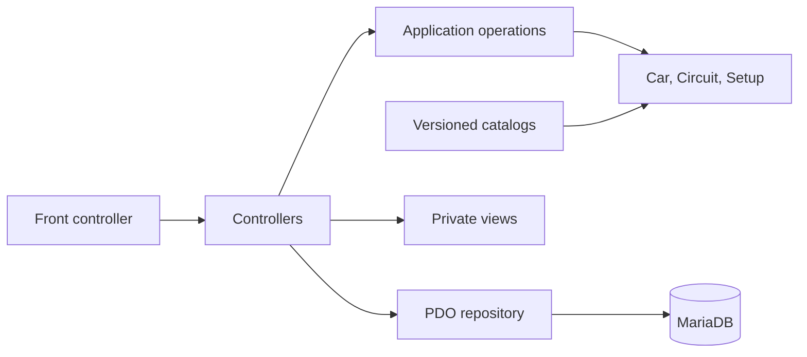

[Versión en Español](es-es/arquitectura.md)

# Architecture

Setup Engineer is a PHP 8.0+ MVC monolith with native browser modules and MariaDB through PDO_MYSQL. It has no framework or production package dependencies.

`Car` provides common numeric validation. `F1Car` specializes it with edition identity and edition-owned presets. `Setup` owns validated values, references and metadata. `Circuit` owns validated identity/profile snapshots. These objects never read HTTP globals or execute SQL. `SetupCodec` adapts published formats and supplies catalog data to the objects.

`Catalog` reads definitions and edition availability from data files. `editions.json` selects parameter and preset sources, so a new compatible season can reuse the existing code without a new list in HTML or JavaScript. A structurally different simulator can implement another `Car` specialization and a separate catalog factory; no unverified simulator data is supplied in advance.

The PDO repository preserves schema-1 personal tables and transactions. Stored JSON is retained instead of silently migrated. A shared real-world circuit identity does not imply equal availability, representations or presets across editions.

`index.php` is the composition root. Two small compatibility entry points forward API and installation URLs; menu screens do not own public PHP scripts. Views remain outside the webroot. The frontend separates transport (`api.js`), in-memory draft (`draft.js`), workspace coordination and notifications. CSS separates tokens, reusable components and workshop layout.

Installation writes its state only after database schema verification. Updates use HTTPS identity and digest validation, an exclusive lock, private backups, atomic file replacement and a recovery journal. Ordinary requests hold a shared lock. Long remote checks release request/session locks.

The new package format intentionally differs from the old updater. The first transition is a documented manual operation, preserving private state and MariaDB; subsequent MVC packages use the browser updater. No infrastructure is modified by the source rewrite itself.
