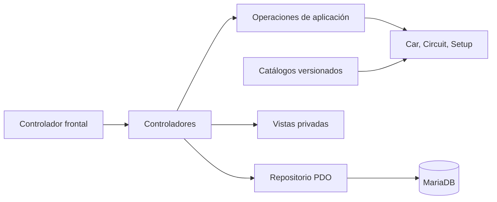

[English version](../architecture.md)

# Arquitectura

Setup Engineer es un monolito MVC con PHP 8.0+, módulos nativos de navegador y MariaDB mediante PDO_MYSQL. No utiliza framework ni dependencias de paquetes de producción.

`Car` aporta la validación numérica común. `F1Car` la especializa con identidad de edición y predeterminados propios. `Setup` conserva valores, referencias y metadatos validados. `Circuit` representa fichas e identidades validadas. Estos objetos no leen HTTP ni ejecutan SQL. `SetupCodec` adapta los formatos publicados y proporciona los datos de catálogo a los objetos.

`Catalog` lee definiciones y disponibilidad desde archivos. `editions.json` selecciona las fuentes de parámetros y predeterminados: una temporada compatible puede reutilizar código sin añadir listas en HTML o JavaScript. Un simulador estructuralmente diferente puede implementar otra especialización de `Car` y una factoría de catálogo separada; no se incluyen datos sin verificar por anticipación.

El repositorio PDO conserva tablas personales del esquema 1 y sus transacciones. Los JSON guardados se mantienen sin migración silenciosa. Compartir una identidad de circuito real no implica igualdad de disponibilidad, representación o predeterminados entre ediciones.

`index.php` compone la aplicación. Dos entradas pequeñas conservan las URL de API e instalación; las pantallas del menú no tienen scripts PHP públicos propios. Las vistas quedan fuera de HTTP. El frontend separa transporte (`api.js`), borrador en memoria (`draft.js`), coordinación del taller y notificaciones. El CSS separa variables, componentes reutilizables y disposición del taller.

La instalación escribe su estado solo después de verificar la base. Las actualizaciones validan identidad y digest mediante HTTPS y utilizan bloqueo exclusivo, backups privados, sustitución atómica y diario de recuperación. Las peticiones normales mantienen un bloqueo compartido. Las consultas remotas largas liberan sesión y bloqueo de petición.

El transporte de releases conserva compatibilidad con 0.4: una envoltura v2 contiene el ZIP MVC v3 completo como datos JSON limitados y verificados mediante hash. Las entradas planas temporales completan en la redirección la transición autorizada mediante POST, cargando el instalador autenticado con streams ZIP de PHP. El instalador registra sustituciones y retiradas explícitas en el mismo diario; no modifica estado privado ni MariaDB. Un reintento recupera antes de continuar, incluido el formato del diario original de 0.4. Después se eliminan el adaptador temporal y los archivos antiguos. Las siguientes actualizaciones MVC abren directamente el mismo transporte sin instalar entradas temporales.
