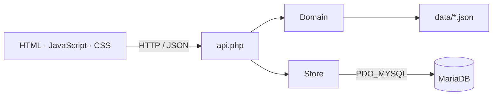

[English version](../architecture.md)

# Arquitectura

Monolito PHP con separación por capas y frontend sin framework. Los puntos de entrada son scripts PHP; la validación y la persistencia están agrupadas en clases.

No sigue MVC formal ni arquitectura hexagonal: `api.php` coordina directamente `Domain` y `Store`, sin capa de servicios ni interfaces de repositorio.

## Stack

| Parte | Tecnología |
| --- | --- |
| Servidor web | Apache |
| Backend | PHP 8.0+ sin framework |
| Base de datos | MariaDB, tablas InnoDB y UTF-8 |
| Acceso a datos | PDO_MYSQL, SQL directo con consultas preparadas |
| Frontend | HTML, JavaScript nativo y CSS puro en archivos separados |
| Comunicación | HTTP y JSON mediante `fetch` |
| Borrador | Estado JavaScript y `localStorage` |
| Catálogos | Archivos JSON versionados |

## Capas y componentes

| Capa | Archivos | Responsabilidad |
| --- | --- | --- |
| Presentación | `public_html/index.php`, `assets/app.js`, `assets/app.css` | Pantalla, navegación y edición del borrador. |
| Entrada HTTP | `public_html/api.php` | Sesión, CSRF, lectura de la petición, selección de acción y respuesta JSON. |
| Dominio | `src/Domain.php` | Validación de reglajes y circuitos, importación y comparación. Lee los catálogos de `data/`. |
| Persistencia | `src/Store.php` | Conexión PDO, consultas, guardado de versiones y transacciones. |

`src/bootstrap.php` carga las clases y proporciona las funciones de configuración y creación de objetos.

## Traducciones

`src/Translation.php` carga los catálogos generados `src/locale_*.php` desde los PO editables de `languages/`. `public_html/i18n.php` sirve los mismos mensajes a JavaScript. `src/Header.php` y `assets/navigation.js` comparten navegación y avisos de actualización entre las pantallas instaladas. El idioma se guarda en una cookie del navegador; no cambia el esquema de la base. Polib es una dependencia exclusiva de desarrollo para generar catálogos. Consulta [traducciones](traducciones.md).

## Almacenamiento

| Tabla | Contenido |
| --- | --- |
| `f125_schema_meta` | Versión del esquema. |
| `f125_circuits` | Identificador y ficha del circuito en JSON. |
| `f125_setups` | Identificador, circuito, nombre, fecha y reglaje en JSON. |
| `f125_migrations` | Identificadores, huellas SQL y fechas de las migraciones aplicadas. |
| `f125_game_presets` | Cinco predeterminados con veinte ajustes numéricos cada uno. |
| `f125_game_circuits` | Nombres oficiales, orden y asignaciones de predeterminados confirmadas. |

Cada guardado inserta una versión nueva. Su JSON contiene referencia, valores actuales, condiciones, notas y una copia de la ficha del circuito. El alta de una ficha junto con su reglaje se ejecuta en una transacción.

El catálogo del juego está separado de las fichas importadas y los reglajes personales. Los nombres por sí solos no forman fichas técnicas. `Migrations` aplica SQL versionado con un bloqueo de la base y registra la huella de cada transacción de datos. Consulta [migraciones de base de datos](migraciones-base-datos.md).

## Instalación y actualización

- `install.php` comprueba requisitos y prepara las tablas mediante `Store`.
- `InstallationState` lee y escribe `config/installation.json`.
- `options.php` guarda el canal de la instalación mediante `UpdateSettings`.
- `GitHubUpdates` lee las versiones publicadas por canal y consulta la release exacta de GitHub solo cuando existe una versión posterior. `GitHubClient` separa la detección de las peticiones autenticadas a GitHub y retira las credenciales al redirigir hacia el almacenamiento.
- `update.php` descarga la compilación seleccionada y delega la validación, copia y sustitución de archivos en `Updater`.
- `Updater` utiliza un bloqueo exclusivo y un registro persistente de recuperación; el arranque comprueba la recuperación antes de cargar el dominio.
- `config/local.php` contiene las credenciales de la base y un token de lectura de GitHub opcional. El canal y la caché se guardan en otros JSON privados.

## Despliegue

Apache sirve únicamente la carpeta pública, llamada `public_html/` en el repositorio. `src/`, `data/`, `config/` y `backups/` quedan fuera de ella.

La navegación y la API usan rutas relativas, tanto en la raíz del sitio como bajo una subcarpeta. Los POST de la API requieren sesión y token CSRF. La aplicación no incluye cuentas de usuario; el control de acceso corresponde al servidor o proxy.
